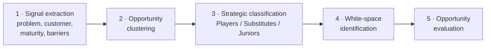

# Quantum Technology Business Opportunity Landscape

**Where is the money in quantum, now? Not in the computers themselves, but in the ecosystem that secures and enables them.**

`LLM analysis pipeline` · `Market strategy` · `Opportunity mapping` · `Responsible AI use`
Carleton University, TIMG 5303 (Machine Learning for Technology Entrepreneurship) · Winter 2026 · Team of 5

---

## Question

Which quantum technology opportunities are commercially actionable today, judged by problem urgency, adoption readiness and how value can be captured?

## Data

**1,673 industry articles published in 2025**, covering commercialization news, research progress, funding, national strategies, partnerships and pilots.

## Method: a hybrid framework run as an LLM pipeline

The approach combines established frameworks (Moon & Lee 2024; Savioz & Blum 2002; Wang et al. 2023; Rotolo et al. 2015), with LLM-based extraction replacing patent analysis.

Every LLM output was reviewed by people, cross-checked against the literature and kept within the course frameworks.

## Findings

| Horizon | Category | Opportunity domains |
|---|---|---|
| Immediate | **Players** | Post-quantum cryptography (PQC); enabling infrastructure & tooling |
| Medium-term | **Substitutes** | Quantum sensing; quantum networking |
| Long-term | **Juniors** | Hardware platforms; application-specific solutions |

**Why PQC leads:** the problem is clear and urgent (future cryptographic risk), regulators and enterprises are already signalling demand, and migration is software-based, so organizations can act now. Value sits in security assessments, migration services and enterprise security platforms.

## White spaces

1. PQC solutions for small and mid-sized businesses
2. Enterprise middleware for integrating quantum into existing systems
3. Commercial sensing applications beyond defence

## Strategic takeaway

> Value in emerging technology goes to those who reduce adoption friction, solve immediate problems and integrate with existing systems, not only to those advancing core performance.

## Limitations
The corpus reflects market narratives and signals, not verified technical performance or ROI. Read the landscape as a signal-based strategic map.

## My role
<!-- Edit: list exactly which stages and sections you led -->
One of five team members on the analysis and report.

**Team:** Milena Sajjan, Bhabna Mukherjee, 'Soji Adewusi, Elizabeth Ibebuogu, Sara Rahbarnoudehi · Supervised by Prof. Stoyan Tanev

## Files
- [`report.pdf`](report.pdf): full report, including the LLM-use disclosure
